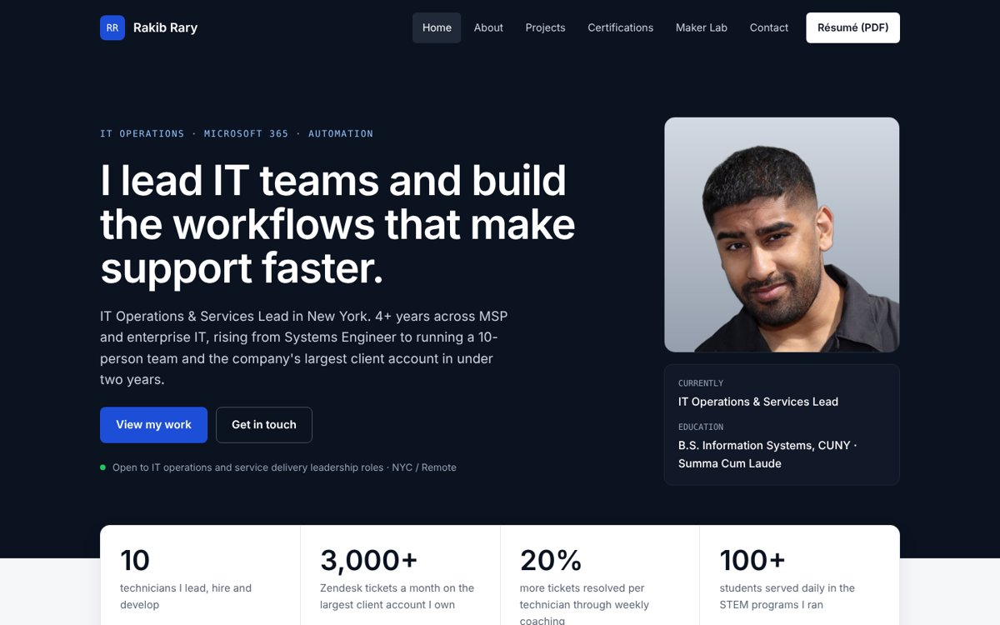

<div align="center">

# Rakib Rary

**IT Operations & Services Lead · Microsoft 365 · ITSM Automation**

New York, NY

[](https://rakibrary.com)
[](https://www.linkedin.com/in/rakibrary)
[](mailto:raryrakib@gmail.com)
[](https://rakibrary.com/assets/Rakib_Rary_Resume.pdf)

<a href="https://rakibrary.com"></a>

</div>

---

## About me

I'm an **IT Operations & Services Lead at ThinkTech IT**, a managed service provider in New York. I lead a team of 10 technicians and own the company's largest client account, and I work with our CTO and VP of IT Operations on operations strategy and the automation roadmap.

I grew from hands-on technician to operations lead through continuous upskilling in systems engineering, computer science and AI. At ThinkTech I consistently ranked #1 in weekly ticket closures as a Systems Engineer, then moved to Team Lead and, within 3 months, to IT Operations & Services Lead. Along the way I built automations that turned manual, repetitive work into scalable processes.

**Some numbers:**

| | |
|---|---|
| 👥 **10** | technicians I lead, hire and develop |
| 🎫 **3,000+** | Zendesk tickets a month on the largest client account I own |
| 📦 **1,000+** | device shipments a month, with biweekly cohorts of 100+ devices and users |
| 🚚 **40%** | faster hardware fulfillment from the procurement order system I built |
| 📈 **20%** | increase in team ticket closures through weekly one-on-ones |
| 💰 **~20%** | cut in monthly wireless costs from a carrier usage audit at Puig |

## What I work with

| Area | Tools |
|---|---|
| **Microsoft 365** | Entra ID, Conditional Access, MFA, Intune, Exchange Online, SharePoint Online, Purview, Azure |
| **IT Operations Platforms** | Zendesk, Atera, ServiceNow, IT Glue, Asset Panda, Apple Business Manager, VoIP (8x8, Grasshopper) |
| **Networking & Security** | NOC/SOC alert triage, incident response, Cisco Meraki, firewalls, VPN |
| **Languages & Frameworks** | C#/.NET, WPF, Python, Bash, PowerShell, HTML/CSS, JavaScript |
| **APIs & Integrations** | REST APIs, Microsoft Graph, Zendesk API, Windows API, Firebase, Webhooks, Git/GitHub |

## Featured work

- **Zendesk workflow redesign:** rebuilt automations, triggers, views, macros and forms from ticket and form-usage data to standardize support across the team.
- **Procurement order system:** one entry completes the Zendesk ticket, generates FedEx/Shippo labels and updates Asset Panda and Intune, cutting hardware fulfillment time by 40%.
- **SSG transition:** led a client's handoff from its previous MSP, then built automation for onboarding/offboarding and hardware tracking.
- **Knowledge base migration:** moved the knowledge base from IT Glue into Zendesk Guide.
- **Side projects:** an RFID access system, Raspberry Pi home security, a 3D-printed robot arm, 48 3D prints and FAA-certified drone photography.

See all of it at **[rakibrary.com/projects](https://rakibrary.com/projects.html)**.

## Education & certifications

- 🎓 **B.S. Information Systems, Summa Cum Laude**, CUNY School of Professional Studies (2025)
- 🎓 **B.A. Urban Studies, Computer Science minor**, CUNY Queens College (2023)
- ✅ Google IT Support Professional Certificate (2024)
- ✅ Belkasoft Windows Digital Forensics (2025)
- ⏳ CompTIA Security+ (expected January 2027)
- ⏳ CompTIA Network+ (expected March 2027)

---

## About this repository

This repo holds the source for **[rakibrary.com](https://rakibrary.com)**, a hand-built portfolio site with no frameworks and no build step, hosted on GitHub Pages.

**Built with:** semantic HTML, modern CSS (grid, flexbox, custom properties) and a small vanilla JavaScript file.

**Features**
- Responsive layout with a collapsible mobile menu
- Filterable project gallery
- Click-to-enlarge viewer for certificates and photos, built on the native `<dialog>` element
- Accessible markup: skip link, keyboard focus styles, alt text and reduced-motion support
- Optimized images (resized to 1600px, ~100–300 KB each) with lazy loading
- Open Graph tags for clean link previews on LinkedIn and Slack

```
├── index.html            Home
├── about.html            Experience, education and toolkit
├── projects.html         Operations work, IT labs, hardware builds
├── certifications.html   Roadmap and certificates
├── maker.html            3D prints, drone and photography, PC build
├── contact.html          Contact links and form
├── 404.html
├── css/style.css
├── js/main.js
└── assets/
    ├── Rakib_Rary_Resume.pdf
    └── img/              projects · certs · prints · drone · photos
```

**Run it locally**

```bash
git clone https://github.com/RakibRary/Rakib-s_Website.git
cd Rakib-s_Website
open index.html        # or: python3 -m http.server 8000
```

Pushing to `main` deploys to rakibrary.com through GitHub Pages. The `CNAME` file keeps the custom domain connected.

---

<div align="center">

**Open to IT operations and service delivery leadership roles in New York City and remote.**

[Get in touch](https://rakibrary.com/contact.html) · [Download résumé](https://rakibrary.com/assets/Rakib_Rary_Resume.pdf)

</div>
